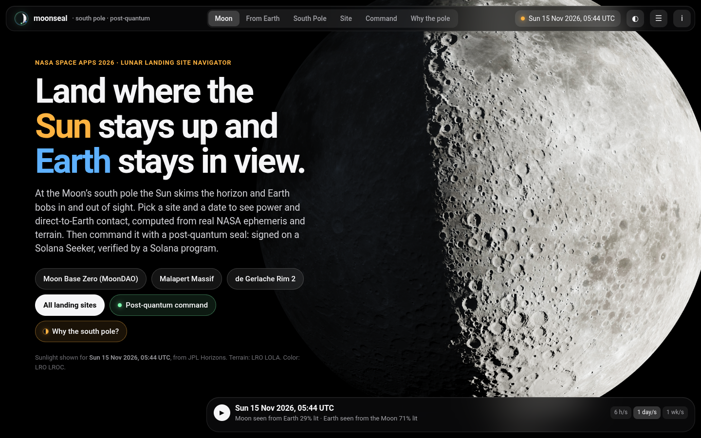
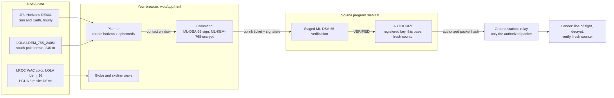

# moonseal

**Find the right day to land. Seal it on Solana.**

moonseal finds the right day to land at the Moon's south pole: it shows which days a lander will have sunlight for power and a clear line to Earth for radio, hour by hour through 2026 and 2027, from NASA JPL Horizons and LRO LOLA data. When you find a good one, moonseal seals it: the finding is signed with ML-DSA-65, NIST's post-quantum signature, and a program on Solana's test network verifies it and keeps it in public, as proof of what was found and when.

Why: at the south pole the Sun barely rises and Earth hides behind the mountains, so a lander that touches down on the wrong day can run out of power or go silent.

NASA Space Apps Challenge 2026 · Challenge #11, Lunar Landing Site Navigator · Florianópolis, Brazil

**Live site: [moonseal.vercel.app](https://moonseal.vercel.app)**



## What it does

- **Shows the good days to land.** Pick a curated site or tap any point on the Moon, choose how long to stay, and moonseal marks every good time to land in 2026 and 2027: the hours when the Sun and Earth clear the real skyline, without gaps longer than your lander can handle. It works from JPL Horizons and LOLA data, entirely in your browser.
- **Ranks the south-pole sites on power, water and radio.** Sunlight and Earth in view over every hour of 2026 and 2027, and where water ice can last (LRO Diviner: under the site, or the distance to the nearest cold trap), each counting the same. MoonDAO's Moon Base Zero comes first.
- **Gives each site a field guide.** Conditions (sunlight, Earth in view, longest night, slope, surface gravity), geology, comparisons with places on Earth, and LRO images of the site, each with its source.
- **Seals what you found.** Press **Seal this site on Solana**: moonseal signs the finding (the site, the good time to land, the stay, what the planner measured, the NASA data) with ML-DSA-65 in your browser, and the moonseal program on Solana verifies the signature on chain. The finding's bytes stay in the public transactions, and the seal id is sha256(key, signature, finding). Change one character and the seal no longer matches. The same program can also gate a base's commands with a list of authorized keys ([post-quantum.md](docs/post-quantum.md)).
- **Asks Solana whether Earth is in view.** On a site, "Ask Solana" sends the point, the hour, the sub-Earth point and distance (JPL Horizons) and the point's skyline (LOLA) to a second program on devnet, which computes Earth's elevation inside the transaction and logs IN VIEW or HIDDEN ([tools/los-onchain](tools/los-onchain/README.md)). Over 70 test cases it agrees with the planner to 0.000001°.

## Try it

```bash
git clone https://github.com/Galmanus/moonseal.git && cd moonseal/web
python3 -m http.server 8787
# then open http://127.0.0.1:8787/app.html
```

No account, wallet or build step is needed: the site is static files in `web/`. To run the on-chain part against a local validator or Solana devnet, or with a wallet on a phone, follow [docs/quickstart.md](docs/quickstart.md).

## How it works



The planner and the command path meet at one point: a command can only reach the lander while Earth is above the lander's skyline, and the planner is what knows when that is. Read the full design in [docs/architecture.md](docs/architecture.md).

## Results

### Planner: the 2026 picture at four NASA candidate regions and MoonDAO's base site

Hourly, 2026, with the Sun or Earth counted as visible when the centre of its disk is above the LOLA terrain horizon.

| Site | Sun above the skyline | Earth above the skyline | Longest night |
|---|---|---|---|
| Connecting Ridge | 91.2% | 50.9% | 101 h |
| Malapert Massif | 81.0% | 100% (worst-hour margin 0.10°) | 277 h |
| de Gerlache Rim 2 | 22.3% | 50.1% | 688 h |
| Peak Near Shackleton | 16.9% | 33.6% | 642 h |
| Moon Base Zero (MoonDAO) | 85.5% | 50.8% | 116 h |

Source: `web/site_stats.js` (generated by `core/export_stats.py` from direct JPL Horizons topocentric tables and the LOLA horizon) and, for Moon Base Zero, the in-browser planner. Small moves matter: Moon Base Zero's centre is 402 m from the Connecting Ridge point and gets 85.5% sunlight against 91.2%.

How the numbers were checked (details in [docs/planner.md](docs/planner.md)):

- **Ephemeris:** the browser's Sun and Earth positions match direct JPL Horizons queries at 4 sites for every hour of 2026, with elevation error at most 0.0007°.
- **Engine parity:** the in-browser planner reproduces the Python engine exactly for 2026 at 5 sites (sunlight, Earth view, longest night, longest blackout).
- **Terrain:** a skyline ray-cast in the browser for a dropped pin is within 0.06° to 0.8° RMS of the engine at the curated sites. The NASA PGDA 5 m site DEMs used for close-up rendering were georeference-checked against the 240 m DEM (median difference 9 to 17 m, against 585 to 6,247 m for mirrored alternatives).

### On chain: ML-DSA-65 verified by a Solana program

An ML-DSA-65 public key (1,952 B) and signature (3,309 B) do not fit a 1,232-byte Solana transaction, and one verification costs about 3.4M compute units, above the 1.4M per-transaction cap. moonseal writes them into a program-owned buffer and verifies in stages.

| Stage | Compute units (LiteSVM) |
|---|---|
| INIT | 872 |
| PREP | 509,361 |
| ROWS 0-1 | 982,975 |
| ROWS 2-3 | 982,964 |
| ROWS 4-5 + FINAL | 1,076,302 |

A full run is 11 transactions (12 with `AUTHORIZE`), each at most 1,155 bytes. `AUTHORIZE` costs 690 to 4,841 compute units. Signatures from the browser (@noble/post-quantum 0.7.1) and from BouncyCastle 1.81 (Java, used by the Android app) verify; tampered ones are rejected. Source: `tools/mldsa-onchain/README.md`, `tools/mldsa-onchain/tests/`.

## Live on Solana devnet

| What | Link |
|---|---|
| Program: ML-DSA-65 verifier and command gate | [`3ieMTX6qafSSwMgdeu8QGCRox1bK84emdwEuD6RShbd7`](https://explorer.solana.com/address/3ieMTX6qafSSwMgdeu8QGCRox1bK84emdwEuD6RShbd7?cluster=devnet) |
| The demo base's command registry | [`2QYth8MJoLCdRgWckS6QTcjjvBoESFcsohRrLxeAoQN6`](https://explorer.solana.com/address/2QYth8MJoLCdRgWckS6QTcjjvBoESFcsohRrLxeAoQN6?cluster=devnet) |
| Signature VERIFIED (command line run) | [`2aoMkbkz...`](https://explorer.solana.com/tx/2aoMkbkzJmtJ4fBaBZGdUQ2jNUvu4mxg2B9SSsk2CkpJfoixzvQSiGcqk1aDCr9NnhaqBppEaP2BtcESGCxiRZ7x?cluster=devnet) |
| Uplink AUTHORIZED (from the web page) | [`3LzG1NYB...`](https://explorer.solana.com/tx/3LzG1NYBPBG5YLJiHYa5rQYzeEuq2kUDXV38ZDmPzF6X63UbNBuq8bkHZ9YcykxwYEqQLLCWiLTzsSQ1CdYPXvMV?cluster=devnet) |
| Refused: valid signature, key not in the registry (error `0x15`) | [`52Pjd7wN...`](https://explorer.solana.com/tx/52Pjd7wNHzd3h6YEUDDiTA62BYE7t4FL38XM1aos2NcLtGb8SekAkR9rp5RWDbdHDermcHAfzcnSHHKnUm643B7i?cluster=devnet) |
| Refused: replayed ticket (error `0x18`) | [`4f7jrwPy...`](https://explorer.solana.com/tx/4f7jrwPysLARj44g5BQ2rcQj78Lzis97ot2LrfmrENjXGyqRHSG9e8A3yEh4wL9nT84wWibtqwk9YVGURAS5L4j6?cluster=devnet) |
| Program upgrade that added the command gate | [`5fLtoYqj...`](https://explorer.solana.com/tx/5fLtoYqjJiEcVLmBxMktwonBdTadmEXbkwNrVBUhjTUtAj5dnoE8ESkTo2ax9KWRzMkTqyJEjCyCKDTQhrCxgk6s?cluster=devnet) |

Each refusal is a failed transaction with a readable log line, for example `moonseal: uplink DENIED: key 8f20eba8 is not in this base's registry`.

## Why the chain carries weight here

A base with no single owner cannot keep its command policy on one operator's server. In moonseal the policy lives in the base's registry account: which ML-DSA-65 keys may command the base, and the highest command counter already used. Only the registry's authority can change it (in production, a multisig of the base's owners). The program accepts a command only if the signature verifies, the key is registered, the signed ticket names this base, and the counter is new. Ground stations then relay only the packet whose hash the base authorized. Without the chain, someone trusted would have to hold the key list, the counter and the record.

The program checks the signature with ML-DSA-65 because the base's commands have to stay unforgeable for the life of the hardware. NIST IR 8547 sets 2030 for deprecating, and 2035 for disallowing, quantum-vulnerable signatures such as RSA and ECDSA. Solana's own ed25519 is not the root of trust for commands.

## Challenge fit

| Challenge #11 asks for | moonseal |
|---|---|
| Compare south-pole landing sites | Curated NASA candidate regions, past landers, Apollo sites for contrast, or any point you tap |
| Compare dates | Any hour of 2026 and 2027, a two-year availability timeline, time to sunset and Earthset |
| Illumination | Sun above the real LOLA skyline, longest night, ray-marched shadows on the globe |
| Earth visibility | Earth above the real skyline, longest blackout, a skyline view with Sun and Earth on it |
| Help a planner decide | A plain-language verdict for a mission of N days, a ranked comparison, the "Why the south pole" explainer |

moonseal then adds what happens after the decision: a command authorized for the window the planner found. See [docs/space-apps.md](docs/space-apps.md).

## Repository layout

```text
web/                     the site (static): app.html is the current app, index.html the first console
  app/                   app code (globe, planner model, UI, command pipeline, explainer) and textures
core/                    Python pipeline: JPL Horizons, LOLA horizon ray-cast, exports for the browser
data/                    JPL Horizons tables used by the pipeline (raw rasters: see docs/data-sources.md)
tools/mldsa-onchain/     Solana program: staged ML-DSA-65 verifier and command gate (Rust), tests
tools/pq-bundle/         pinned @noble/post-quantum build for the browser
tools/wallet-bundle/     pinned Solana wallet connection (Mobile Wallet Adapter, Wallet Standard)
solana/client/           JavaScript client: staged runs, registry tool, end-to-end and rate-limit tests
solana/programs/         first prototype: Anchor program for ground-station contact windows
android/                 Android app (ML-DSA-65 signing with BouncyCastle 1.81)
java-spike/              Java spike of the signed command format
docs/                    documentation
```

## Documentation

| Page | What it covers |
|---|---|
| [Quickstart](docs/quickstart.md) | Run the site, the local validator, devnet, a wallet on a phone, and the tests |
| [Architecture](docs/architecture.md) | Components, data flow and a file map |
| [Planner methods and validation](docs/planner.md) | Ephemeris, terrain horizon, metrics, checks, uncertainty |
| [Post-quantum command path](docs/post-quantum.md) | ML-DSA-65, ML-KEM-768, the lander's gates, the hybrid seal with your Solana wallet |
| [On-chain reference](docs/onchain.md) | Accounts, instructions, ticket format, errors, costs, client API |
| [Security model](docs/security.md) | Threats, mitigations, the test for each, trust assumptions |
| [Data sources](docs/data-sources.md) | Every NASA dataset, how it is used, how to regenerate |
| [Space Apps submission notes](docs/space-apps.md) | How the project maps to Challenge #11 |

## Limits

- **Terrain resolution.** Horizons come from the 240 m LOLA DEM: no boulders, no slopes below that scale. The 5 m site DEMs sharpen the 3D close-ups only.
- **Line of sight, not a link budget.** "Earth visible" means the centre of Earth is above the skyline. Antenna masks, power and data rates are not modeled.
- **Fragile results are flagged.** Malapert's continuous Earth view rests on a 0.10° margin. NASA LCRNS's 17-43% direct-to-Earth band is not reproduced by line of sight; a 5° antenna mask gives 41.2% at Malapert.
- **One point per region.** NASA's candidate regions are areas. moonseal evaluates one representative point per region, taken from the cited source, and results change within a region.
- **Prototype security.** The on-chain verifier is new code, tested against two independent ML-DSA implementations but not audited. On devnet the registry authority and the program's upgrade authority are single keys, and the demo operator key is derived from a public seed so anyone can try the page. See [docs/security.md](docs/security.md).
- **Not flight software.** This is a hackathon prototype, not a NASA product and not flight-qualified.

## Credits and disclaimers

- **NASA data:** JPL Horizons (DE441); LRO LOLA LDEM_75S_240M and ldem_16; LRO LROC WAC color mosaic via NASA SVS CGI Moon Kit #4720; NASA PGDA LOLA 5 m/px south-pole site DEMs (Barker et al. 2021); NASA Blue Marble (SVS #2915). This project uses NASA data and is not endorsed by NASA.
- **LRO images in the field guide:** Lunar Reconnaissance Orbiter Narrow Angle Camera frames, credit NASA/GSFC/Arizona State University (LROC terms: educational use with credit).
- **MoonDAO:** Moon Base Zero's coordinates come from MoonDAO's open-source repository (commit `0a9d527`). moonseal is not affiliated with or endorsed by MoonDAO.
- **Solana:** Solana is a product of its respective owners. moonseal is not affiliated with or endorsed by them.
- **Use of AI:** an AI coding assistant (Claude) helped write and verify the code. All data is real NASA data, and no imagery is AI-generated.

## License

MIT, see [LICENSE](LICENSE). Bundled third-party code keeps its own licenses, listed in [THIRD_PARTY_NOTICES.md](THIRD_PARTY_NOTICES.md).
