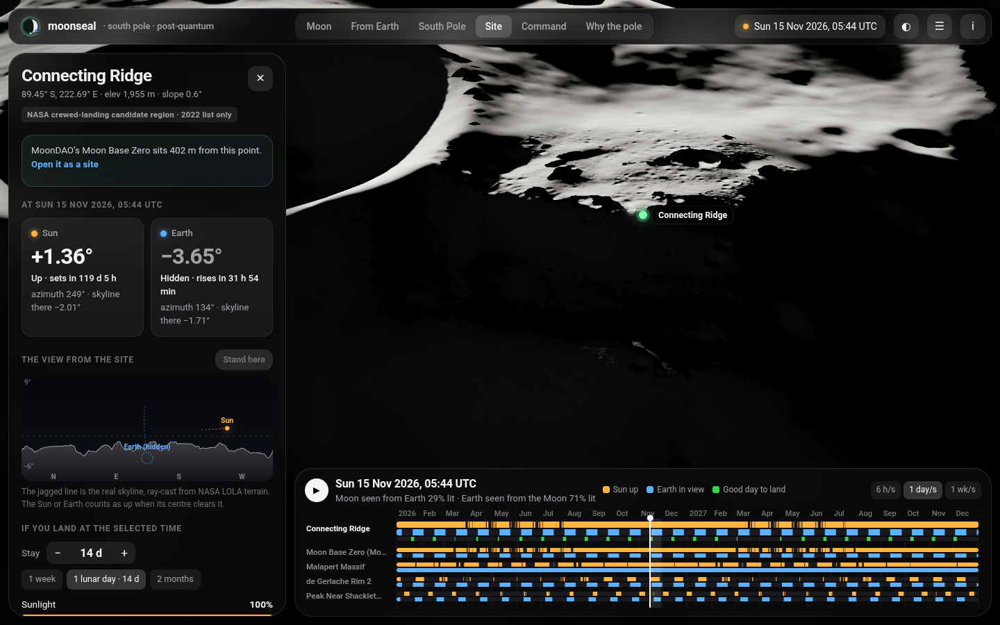
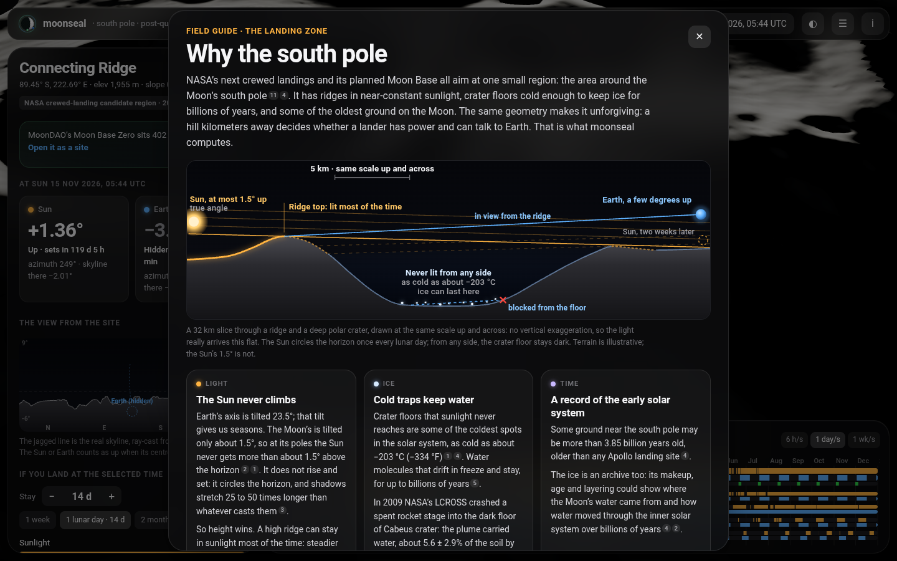
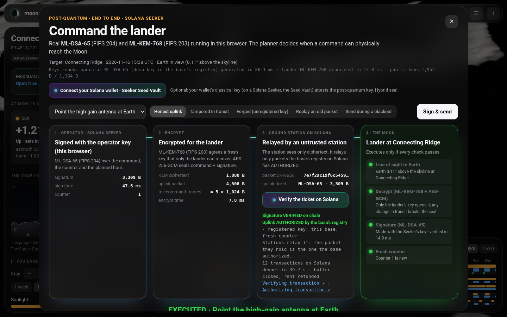
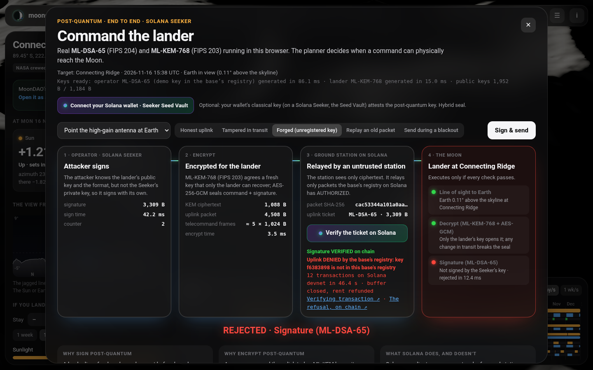

# moonseal documentation

moonseal plans when a lunar south-pole site has sunlight and a line of sight to Earth, then carries a post-quantum signed command to the lander inside that window, with a Solana program deciding who may command the base.

## Start here

| If you want to | Read |
|---|---|
| Run the site in two minutes | [Quickstart](quickstart.md) |
| See how the pieces fit | [Architecture](architecture.md) |
| Check how the landing-window numbers are computed and validated | [Planner methods and validation](planner.md) |
| Understand the signed and encrypted command path | [Post-quantum command path](post-quantum.md) |
| Build against the Solana program | [On-chain reference](onchain.md) |
| Review threats and trust assumptions | [Security model](security.md) |
| Trace every dataset back to NASA | [Data sources](data-sources.md) |
| Map the project to NASA Space Apps Challenge #11 | [Space Apps submission notes](space-apps.md) |

## Conventions

- Longitudes are east-positive, in degrees, in the Moon's mean-Earth (`MOON_ME`) body-fixed frame, the frame of both LOLA and the JPL Horizons tables used here.
- Azimuth is measured east of north. Elevation is in degrees above the local horizontal plane.
- "Visible" means the centre of the Sun's or Earth's disk is above the terrain horizon at that azimuth.
- Times are UTC.
- Every number in these pages comes from a file in this repository or from a run whose command is given next to it. When something was not verified, the page says so.

## Screenshots

| | |
|---|---|
|  |  |
|  |  |
