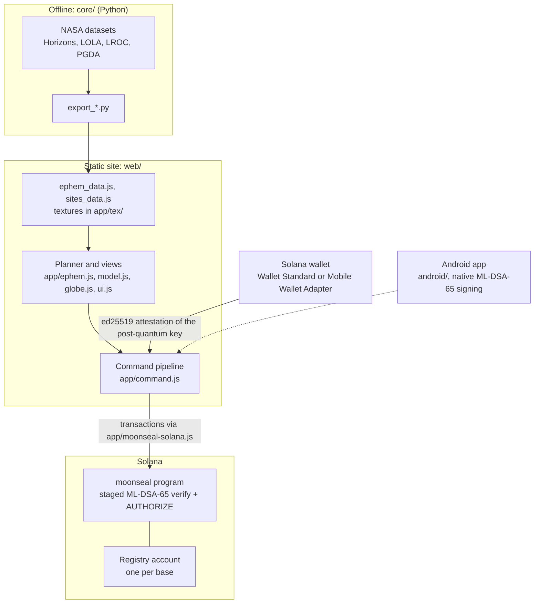
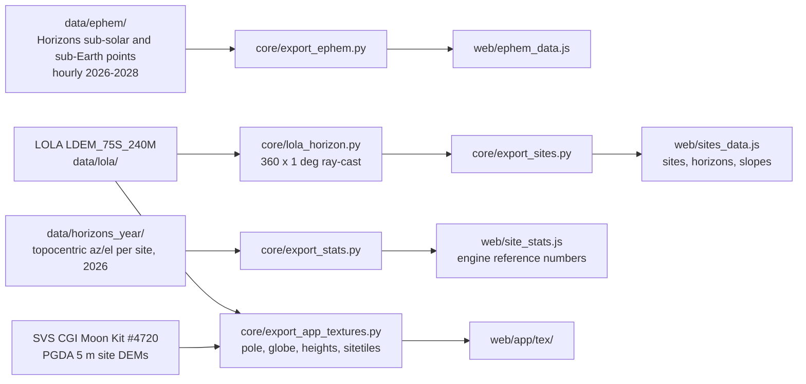
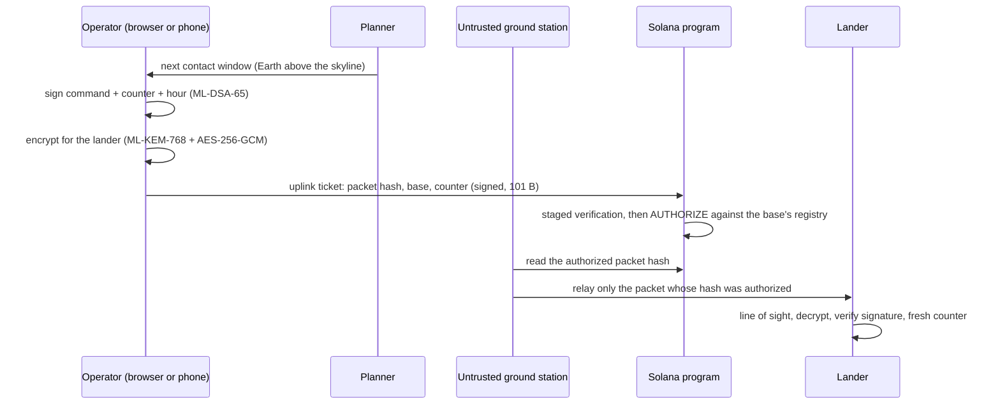

# Architecture

moonseal has four parts. An offline **data pipeline** (Python, `core/`) turns NASA datasets into compact files for the browser. A static **web app** (`web/app.html`) plans landing windows, renders the Moon and runs the command pipeline. A **Solana program** (`tools/mldsa-onchain`) verifies post-quantum signatures and keeps each base's command policy. An **Android app** (`android/`) signs commands natively on the phone.

## Data pipeline

Everything the browser shows is precomputed from NASA data or computed in the browser from precomputed tables. Nothing calls a server at run time, except the optional Solana RPC.

`web/site_stats.js` is not loaded by the app. It is the engine's reference output: the in-browser planner (`web/app/model.js`) applies the same rule and its numbers match these, which is how browser and engine are cross-checked. See [planner.md](planner.md).

## The web app

`web/app.html` loads, in order: `three-bundle.js` (three.js 0.187.0), `ephem_data.js`, `sites_data.js`, then the app modules.

| Module | Role |
|---|---|
| `app/ephem.js` | Sun and Earth azimuth and elevation for any site and hour, from the sub-point tables, with Earth's topocentric parallax |
| `app/model.js` | The planner: visibility against the terrain horizon, availability, longest night and blackout, countdowns |
| `app/globe.js` | The renderer: LROC color and LOLA relief on the globe, the polar cap from LOLA with ray-marched shadows, site close-ups |
| `app/radio.js` | Signal to Earth: a lander can radio Earth when Earth clears the site's skyline and a NASA Deep Space Network dish (Goldstone, Madrid, Canberra) has the Moon at least 10° up. The Moon's place in Earth's sky comes from the Astronomical Almanac low-precision series and sidereal time (at worst 0.256° from JPL Horizons over 2026-2027); strength from a free-space link budget for a stated reference radio; plus the live NASA DSN Now feed, filtered to Moon spacecraft. Tests: `node --test tests/radio.test.mjs` |
| `app/budget.js` | The render budget: each frame's GPU time (a WebGL timer query, or the frame interval where the browser has none) steps resolution and shadow steps down on a GPU that cannot keep up. Tests: `node --test tests/budget.test.mjs` |
| `app/site_tiles.js` | Loads the NASA PGDA 5 m site DEMs as a third level of detail for close-ups |
| `app/ui.js` | Views (Moon, South Pole, Site, Command), the Why-the-south-pole entry on the opening screen, the site panel (the answer first, technical detail folded under More details), timeline, comparison |
| `app/why-pole.js` | The "Why the south pole" explainer, with its sources and a live 2026 table |
| `app/command.js` | The command pipeline: keys, signing, encryption, the lander's gates, the on-chain step |
| `app/pq-bundle.js` | @noble/post-quantum 0.7.1 (ML-DSA-65, ML-KEM-768), pinned and bundled |
| `app/moonseal-solana.js` | The Solana client (`solana/client/moonseal-onchain.mjs`), loaded only when you press "Check it on Solana" |
| `app/wallet-bundle.js` | Mobile Wallet Adapter and Wallet Standard, loaded only when you press "Connect your Solana wallet" |
| `app/onchain-config.js` | Networks to try (local validator, then devnet), program id, the demo base's registry, the demo operator seed |

The first console (`web/index.html`) and the first Solana demo (`web/solana-demo.html`) are kept for reference. They use `windows_data.js`, `moon_dem.js` and `solana-bundle.js`.

## The command path

The lander's gates and the five scenarios (honest, tampered in transit, forged, replay, blackout) are described in [post-quantum.md](post-quantum.md). The program's accounts, instructions and errors are in [onchain.md](onchain.md).

## The Solana program

`tools/mldsa-onchain` is a native Solana program (no framework), written for the SBF virtual machine:

- `src/mldsa65.rs` is an ML-DSA-65 verifier that keeps every polynomial on the heap and uses unsigned arithmetic only. The `fips204` crate needs a stack frame of about 98 KB, and SBF allows 4 KB per frame. Signed arithmetic cost about 13.5M compute units in total; unsigned costs 3.4M.
- `src/lib.rs` splits verification into stages that each fit one transaction, and adds the command registry and `AUTHORIZE`.

`solana/programs/lunar_contacts` is the project's first Solana prototype, an Anchor program for ground-station contact windows (`register_station`, `post_window`, `claim_window`, `confirm_contact`). It is deployed on devnet at `HuBV5gmKwQJvJuGvHLSY58hq2DE76khJYMrCzz6ipFYk` and used by `web/solana-demo.html`. It does not verify signatures.

## The Android app

`android/` is a WebView app that wraps the first console and exposes a native bridge (`LunarBridge.kt`): `signMLDSA(payload)`, `verifyMLDSA(payload, sig)` and `publicKeyB64()`, implemented with BouncyCastle 1.81. ML-DSA-65 signatures made by BouncyCastle and by the browser's library verify each other in both directions, and both verify on chain.

Three things are pending, and the code says so:

- The private ML-DSA key is stored in the app's files instead of being wrapped by the Android Keystore (`LunarBridge.kt`, header comment).
- The app's bundled web assets are still the first console (`index.html`), not `app.html`.
- The bridge signs text, not raw bytes. When `app.html` runs with the bridge, `command.js` therefore signs the binary uplink ticket with the demo operator key.

## File map

| Path | Contents |
|---|---|
| `web/app.html`, `web/app/` | The current app and its modules, brand assets and textures |
| `web/index.html` | The first console |
| `web/ephem_data.js`, `web/sites_data.js` | Ephemeris and site tables loaded by the app |
| `web/site_stats.js` | Engine reference statistics for 2026 |
| `web/three-bundle.js` | three.js 0.187.0, built from `web/_moon_entry.js` |
| `core/` | Data pipeline and the terrain horizon (`lola_horizon.py`), with tests in `core/tests/` |
| `data/` | JPL Horizons tables used by the pipeline |
| `tools/mldsa-onchain/` | The Solana program, its tests (`tests/`), fixtures and `deploy-devnet.sh` |
| `tools/pq-bundle/`, `tools/wallet-bundle/` | Pinned sources of the two browser bundles |
| `solana/client/` | Client library, registry tool, end-to-end, rate-limit and diagnostic scripts |
| `solana/programs/lunar_contacts/` | First Solana prototype (Anchor) |
| `android/` | Android app |
| `java-spike/` | Java spike of the signed command format |
