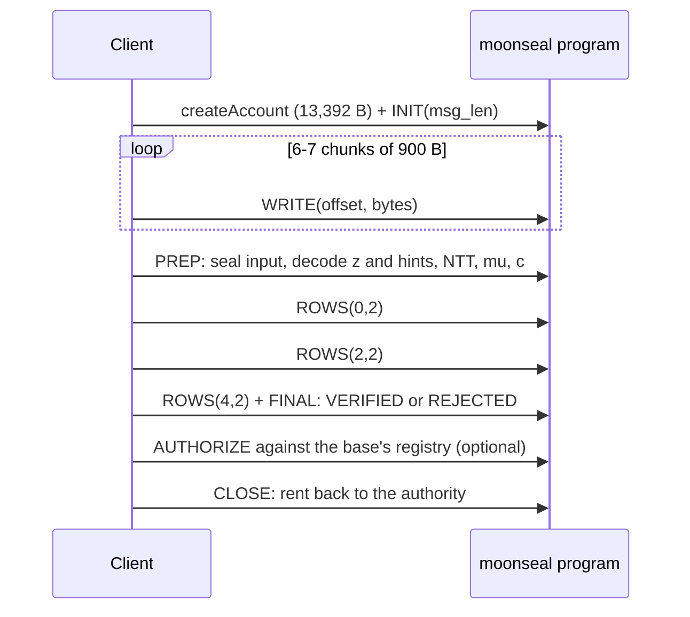

# On-chain reference

The moonseal program verifies ML-DSA-65 (FIPS 204) signatures inside the Solana runtime and keeps, for each base, the policy of who may command it. Source: `tools/mldsa-onchain/src/lib.rs` (protocol) and `src/mldsa65.rs` (verifier).

| | |
|---|---|
| Program id (devnet) | `3ieMTX6qafSSwMgdeu8QGCRox1bK84emdwEuD6RShbd7` |
| Demo base registry (devnet) | `2QYth8MJoLCdRgWckS6QTcjjvBoESFcsohRrLxeAoQN6` |
| Framework | none (native `solana-program` 2.2.1) |
| Client | `solana/client/moonseal-onchain.mjs`, bundled for the browser as `web/app/moonseal-solana.js` |

## Why verification is staged

An ML-DSA-65 public key is 1,952 bytes and a signature 3,309 bytes. Together they do not fit a 1,232-byte transaction, and one verification costs about 3.4M compute units, above the 1.4M per-transaction cap. So the key, signature and message are written into a program-owned **buffer** account in 900-byte chunks, and verification runs as a fixed sequence of transactions, each under both limits:



A run is 11 transactions for a short message, 12 with `AUTHORIZE`, plus `CLOSE`.

## Buffer account

Owned by the program, 13,392 bytes.

| Offset | Size | Field |
|---|---|---|
| 0 | 1 | Magic `M` |
| 1 | 1 | Version, `1` |
| 2 | 1 | Stage: `1` writing, `2` prepped, `3` done |
| 3 | 1 | Result: `0` pending, `1` VERIFIED, `2` REJECTED |
| 4 | 1 | Rows of w1 computed, `0` to `6` |
| 5 | 2 | Message length, u16 LE, at most 1,024 |
| 7 | 32 | Authority: the key that must sign every instruction on this buffer |
| 39 | 32 | Commitment `sha256(pk ‖ sig ‖ msg)`, set at PREP |
| 71 | 32 | Key id `sha256(pk)`, set at PREP |
| 128 | 1,952 + 3,309 + msg | Public key, signature, message |
| 6,416 | 64 | μ |
| 6,480 | 1,024 | ĉ, 256 x u32 |
| 7,504 | 5,120 | ẑ, 5 x 256 x u32 |
| 12,624 | 768 | w1Encode, 6 x 128 bytes |

## Registry account

One per base, owned by the program, exactly 384 bytes. The size and the magic byte keep a buffer from passing for a registry, and the reverse.

| Offset | Size | Field |
|---|---|---|
| 0 | 1 | Magic `R` |
| 1 | 1 | Version, `1` |
| 2 | 1 | Number of authorized keys, at most 8 |
| 8 | 32 | Authority: the only key that may edit the registry |
| 40 | 8 | Highest counter authorized so far, u64 LE (the replay guard) |
| 48 | 8 | Planned hour of the last authorized uplink, i64 LE |
| 56 | 32 | SHA-256 of the last authorized uplink packet: what ground stations compare against |
| 88 | 8 | Slot in which it was authorized, u64 LE |
| 96 | 32 | Key id that signed it |
| 128 | 8 x 32 | Authorized key ids, `sha256` of each ML-DSA-65 public key |

## Uplink ticket

The message the operator signs for `AUTHORIZE`. 101 bytes.

| Offset | Size | Field |
|---|---|---|
| 0 | 4 | ASCII `MSUT` |
| 4 | 1 | Version, `1` |
| 5 | 32 | Registry address: binds the ticket to one base |
| 37 | 8 | Counter, u64 LE |
| 45 | 8 | Planned hour, i64 LE |
| 53 | 32 | SHA-256 of the encrypted uplink packet |
| 85 | 16 | Site id, ASCII, zero-padded |

The same layout is built by `uplinkTicket()` in `solana/client/moonseal-onchain.mjs`, `uplinkTicket()` in `web/app/command.js`, and `tests/gen-gate-fixtures.mjs`.

## Instructions

The first byte of instruction data selects the instruction.

| Tag | Name | Accounts | Data | Effect |
|---|---|---|---|---|
| 0 | `INIT` | buffer (w), authority (s) | `u16` message length | Initializes a zeroed buffer and records the authority. Sent in the same transaction as `createAccount`. |
| 1 | `WRITE` | buffer (w), authority (s) | `u16` offset, bytes | Copies bytes into the data region. Refused after `PREP`. |
| 2 | `PREP` | buffer (w), authority (s) | none | Seals the input, records the commitment and key id, decodes and range-checks z and the hints, computes μ and c. A malformed signature ends here as REJECTED. |
| 3 | `ROWS` | buffer (w), authority (s) | `u8` first row, `u8` count | Computes rows of w1, in order. After row 6, recomputes the challenge hash and compares it with the signature's: VERIFIED or REJECTED. |
| 4 | `CLOSE` | buffer (w), authority (s, w) | none | Returns the buffer's lamports to the authority and zeroes it. Works at any stage. |
| 5 | `VERIFY_ONE` | buffer (w), authority (s) | none | Whole verification in one call, for tests and runtimes with a larger budget. |
| 6 | `REG_INIT` | registry (w), authority (s) | none | Initializes a zeroed 384-byte registry and records its authority. |
| 7 | `REG_ADD` | registry (w), authority (s) | key id, 32 bytes | Authorizes a key. Authority only. |
| 8 | `REG_REMOVE` | registry (w), authority (s) | key id, 32 bytes | Revokes a key. Authority only. |
| 9 | `AUTHORIZE` | buffer, registry (w) | none | Permissionless. Turns a VERIFIED buffer into an authorized uplink, or refuses with a reason. |

Every buffer instruction after `INIT` must be signed by the authority recorded at `INIT`. Verification is deterministic, so this protects the buffer from griefing; it is not a trust assumption.

## `AUTHORIZE` rules

`AUTHORIZE` checks, in this order, and stops at the first failure:

1. The buffer is owned by the program, initialized, and at least 13,392 bytes.
2. The registry is owned by the program, exactly 384 bytes, and initialized.
3. The buffer is DONE with result VERIFIED. (`0x14`)
4. The buffer's key id is in the registry. (`0x15`)
5. The signed message is a 101-byte uplink ticket. (`0x16`)
6. The ticket names this registry. (`0x17`)
7. The ticket's counter is above the registry's counter. (`0x18`)

On success, the registry records the counter, hour, packet hash, slot and key id, and the program logs:

```text
moonseal: uplink AUTHORIZED counter 1794720484454 packet a70754c0 key 219ef77c
```

On a refusal, the transaction fails with a custom error and a readable log line, for example:

```text
moonseal: uplink DENIED: key 8f20eba8 is not in this base's registry
```

The client sends `AUTHORIZE` with preflight disabled on purpose, so that a refusal lands on chain and is visible on Solana Explorer.

## Errors

| Code | Hex | Instruction | Meaning |
|---|---|---|---|
| 1 | `0x1` | any | Instruction data too short |
| 2 | `0x2` | `INIT` | Message longer than 1,024 bytes |
| 3 | `0x3` | buffer instructions | Signer is not the buffer's authority |
| 4 | `0x4` | `WRITE` | Input already sealed by `PREP` |
| 5 | `0x5` | `WRITE` | Write outside the data region |
| 6 | `0x6` | `PREP` | Buffer is not in the writing stage |
| 7 | `0x7` | `ROWS` | Buffer is not prepped |
| 8 | `0x8` | `ROWS` | Rows out of order, repeated, empty, or past row 6 |
| 20 | `0x14` | `AUTHORIZE` | Signature is not VERIFIED |
| 21 | `0x15` | `AUTHORIZE` | Key is not in this base's registry |
| 22 | `0x16` | `AUTHORIZE` | Signed message is not an uplink ticket |
| 23 | `0x17` | `AUTHORIZE` | Ticket was signed for another base |
| 24 | `0x18` | `AUTHORIZE` | Replay: counter is not above the last authorized one |
| 25 | `0x19` | `REG_ADD` | Registry is full (8 keys) |
| 26 | `0x1a` | `REG_ADD` | Key is already registered |
| 27 | `0x1b` | `REG_REMOVE` | Key is not registered |
| 28 | `0x1c` | `REG_ADD`, `REG_REMOVE` | Signer is not the registry's authority |
| 29 | `0x1d` | registry instructions, `AUTHORIZE` | Account is not a registry (wrong size) |

The program also returns standard `ProgramError` values: `IncorrectProgramId` (account not owned by the program), `MissingRequiredSignature`, `AccountDataTooSmall`, `AccountAlreadyInitialized` (`INIT` or `REG_INIT` on a used account), `UninitializedAccount`, `NotEnoughAccountKeys`, `InvalidInstructionData` (unknown tag) and `InvalidArgument` (`VERIFY_ONE` on an invalid signature).

## Costs

Compute units per stage, measured in LiteSVM 0.6.1 and on devnet (devnet values include the two compute-budget instructions):

| Stage | LiteSVM | Devnet run, 15 Nov 2026 |
|---|---|---|
| INIT (devnet: in the same transaction as `createAccount`) | 872 | 1,020 |
| WRITE (each) | | 898 |
| PREP | 509,361 | 520,946 |
| ROWS 0-1 | 982,975 | 982,999 |
| ROWS 2-3 | 982,964 | 982,985 |
| ROWS 4-5 + FINAL | 1,076,302 | 1,076,322 |
| CLOSE | | 965 |

- Every transaction is at most 1,155 bytes.
- `AUTHORIZE` costs 690 to 4,841 compute units, depending on how far it gets (local validator, `solana/client/e2e-gate.mjs`).
- Fees on devnet were 5,000 lamports per signature. `create + INIT` carries two signatures (payer and buffer).
- The buffer's rent deposit (68,681,600 lamports on devnet) returns to the authority at `CLOSE`. A registry's rent deposit was 2,600,960 lamports.

The devnet column comes from `solana/client/decode-run.mjs`, which maps every transaction of one buffer to its stage.

## Client API

`solana/client/moonseal-onchain.mjs` runs in Node, Bun and the browser. It confirms transactions by HTTP polling, not WebSockets, because sandboxes and venue Wi-Fi often block `wss`.

```js
import { verifyOnChain, createRegistry, registryKey, readRegistry, uplinkTicket } from "./moonseal-onchain.mjs";

const r = await verifyOnChain({
  rpc: "https://api.devnet.solana.com",       // or connection: an existing Connection
  programId: "3ieMTX6qafSSwMgdeu8QGCRox1bK84emdwEuD6RShbd7",
  payer,                                       // a Keypair with SOL
  pk, sig, msg,                                // Uint8Arrays: ML-DSA-65 key, signature, message
  registry: "2QYth8MJoLCdRgWckS6QTcjjvBoESFcsohRrLxeAoQN6", // optional: run AUTHORIZE
  onStep: s => console.log(s.i, s.n, s.label, s.sig),
});
// r.verified, r.keyId, r.commit, r.sigs, r.verifySig, r.closeSig
// with a registry: r.authorized, r.authSig, r.authReason, r.registryState
```

| Function | Returns |
|---|---|
| `verifyOnChain(options)` | The run's result. On failure it throws, and the error carries `buffer` and, if the half-written buffer was closed, `closeSig`. |
| `createRegistry({ rpc, programId, payer, registry, authority })` | Signature of `createAccount` + `REG_INIT`. `registry` is a Keypair; its address is what tickets name. |
| `registryKey({ rpc, programId, payer, registry, authority, keyId, remove })` | Signature of `REG_ADD`, or `REG_REMOVE` when `remove` is true. |
| `readRegistry({ rpc, registry })` | `{ authority, keys, counter, hour, slot, packet, keyId }`, or `null`. |
| `uplinkTicket({ registry, counter, hour, packetSha, site })` | The 101-byte ticket. |

### Rate limits

The public devnet endpoint rate-limits per IP and per method with HTTP 429. The client:

- retries rate-limited calls that are safe to repeat, with exponential backoff (1.5 s, doubling, up to six attempts);
- re-sends the **same signed bytes** when a send is rate-limited, so a stage can never run twice;
- reuses a blockhash for 20 s to make fewer calls;
- closes the half-written buffer when a run fails, so the payer gets its rent back.

`solana/client/test-ratelimit.mjs` checks all of this against a local validator, replaying the exact 429 response devnet returned.

### Command-line tools

| Script (in `solana/client`) | Use |
|---|---|
| `registry.mjs` | `create`, `add-demo-operator`, `add`, `remove`, `show` for a base's registry |
| `devnet-moonseal.mjs` | Verify the fixture signature on a cluster and print every transaction |
| `e2e-moonseal.mjs` | Browser, BouncyCastle and tampered signatures against a validator |
| `e2e-gate.mjs` | Honest, replay, forged key, other base and tampered tickets through `AUTHORIZE` |
| `test-ratelimit.mjs` | Rate-limit and cleanup regression test |
| `close-buffer.mjs` | Close a buffer left open by an interrupted run |
| `decode-run.mjs` | List a buffer's transactions with their stage and compute units |
| `payer-runs.mjs` | Group a payer's recent transactions into runs |

## Setting up a base

1. Generate a keypair for the registry. Its address is the base's identity in tickets.
2. Create the registry with the base's authority: `bun registry.mjs <rpc> <programId> create <payer.json> <registry.json> [authority.json]`.
3. Authorize operator keys: `bun registry.mjs <rpc> <programId> add <payer.json> <registry> <keyIdHex> [authority.json]`, where the key id is the SHA-256 of the operator's ML-DSA-65 public key.
4. Point clients at the registry (`registry` in `web/app/onchain-config.js` for the web page).

For production, the authority should be a multisig of the base's owners, and the program's upgrade authority should be the same multisig, or removed.

## Using a verified buffer from another program

A program that trusts a moonseal buffer must check: the buffer's owner is this program, its magic and version, stage DONE, result VERIFIED, and the key id against its own policy. The verifier proves "this key signed this message"; the registry, or your program, decides whose key matters.

## Deployments on devnet

| Item | Address or signature |
|---|---|
| Program | [`3ieMTX6qafSSwMgdeu8QGCRox1bK84emdwEuD6RShbd7`](https://explorer.solana.com/address/3ieMTX6qafSSwMgdeu8QGCRox1bK84emdwEuD6RShbd7?cluster=devnet) |
| Demo base registry | [`2QYth8MJoLCdRgWckS6QTcjjvBoESFcsohRrLxeAoQN6`](https://explorer.solana.com/address/2QYth8MJoLCdRgWckS6QTcjjvBoESFcsohRrLxeAoQN6?cluster=devnet), demo operator key id `219ef77c...` |
| Upgrade adding the command gate | [`5fLtoYqj...`](https://explorer.solana.com/tx/5fLtoYqjJiEcVLmBxMktwonBdTadmEXbkwNrVBUhjTUtAj5dnoE8ESkTo2ax9KWRzMkTqyJEjCyCKDTQhrCxgk6s?cluster=devnet) |
| VERIFIED, command line | [`2aoMkbkz...`](https://explorer.solana.com/tx/2aoMkbkzJmtJ4fBaBZGdUQ2jNUvu4mxg2B9SSsk2CkpJfoixzvQSiGcqk1aDCr9NnhaqBppEaP2BtcESGCxiRZ7x?cluster=devnet) |
| AUTHORIZED, web page | [`3LzG1NYB...`](https://explorer.solana.com/tx/3LzG1NYBPBG5YLJiHYa5rQYzeEuq2kUDXV38ZDmPzF6X63UbNBuq8bkHZ9YcykxwYEqQLLCWiLTzsSQ1CdYPXvMV?cluster=devnet) |
| DENIED `0x15`, valid signature, unregistered key | [`52Pjd7wN...`](https://explorer.solana.com/tx/52Pjd7wNHzd3h6YEUDDiTA62BYE7t4FL38XM1aos2NcLtGb8SekAkR9rp5RWDbdHDermcHAfzcnSHHKnUm643B7i?cluster=devnet) |
| DENIED `0x18`, replay | [`4f7jrwPy...`](https://explorer.solana.com/tx/4f7jrwPysLARj44g5BQ2rcQj78Lzis97ot2LrfmrENjXGyqRHSG9e8A3yEh4wL9nT84wWibtqwk9YVGURAS5L4j6?cluster=devnet) |
| First prototype, `lunar_contacts` (Anchor) | [`HuBV5gmKwQJvJuGvHLSY58hq2DE76khJYMrCzz6ipFYk`](https://explorer.solana.com/address/HuBV5gmKwQJvJuGvHLSY58hq2DE76khJYMrCzz6ipFYk?cluster=devnet) |

On devnet, the program's upgrade authority and the demo registry's authority are the same single wallet.
